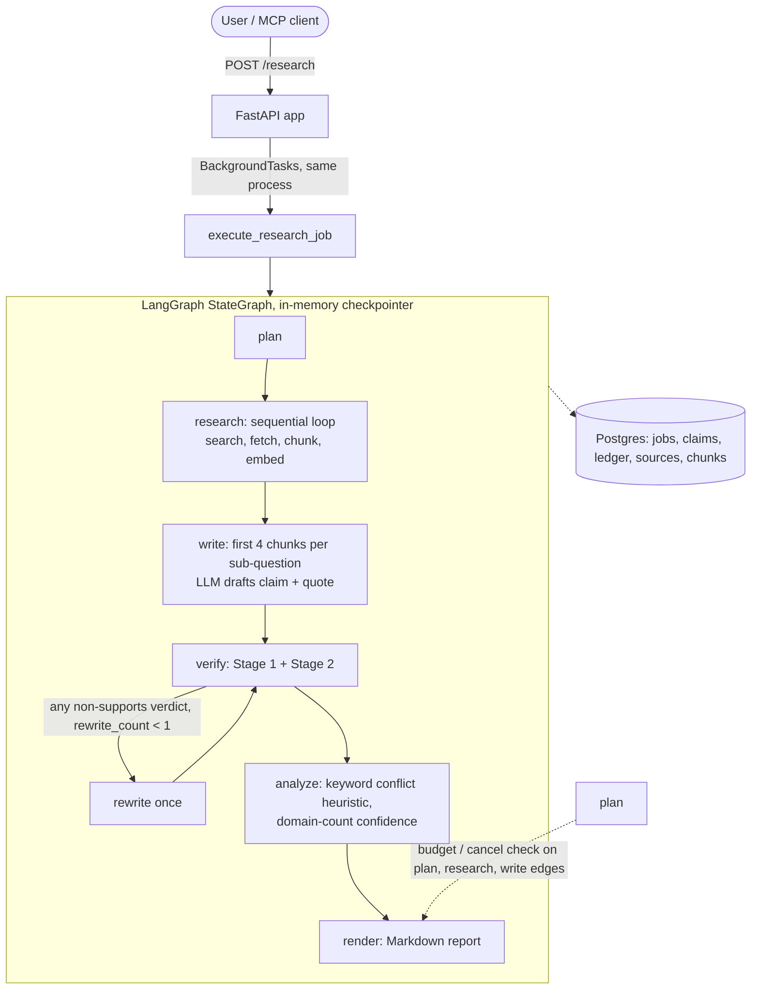

# CiteGuard: Budget-Bounded Research Pipeline with Citation Checks

> **Status: work in progress.** Measured so far: verifier accuracy on 24 synthetic, author-labeled hard cases and cost/latency on 10 real pipeline runs ([RESULTS.md](RESULTS.md)). Precision/recall on human-labeled real claims is **not measured yet**. Earlier synthetic metrics were removed (see [AUDIT.md](AUDIT.md)).

CiteGuard takes a research question, splits it into sub-questions, fetches web pages, has an LLM draft claims that each cite a quote from a page, and then checks every claim with a two-stage verifier before putting it in a Markdown report. All LLM calls go through one gateway (`app/core/llm.py`) that enforces a token budget and writes a ledger row per call.

"Verified" here means *the quote was found in the fetched page and a second model judged that the quote supports the claim*. It does **not** mean the claim is true.

---

## 1. What the code does today



- **API**: FastAPI (`app/main.py`). `POST /research` creates a job row and runs the pipeline as a FastAPI background task in the API process.
- **Budget**: `call_llm` checks job and per-phase token caps before each call (research 50%, writing 15%, verifying 25%, planning 10%, reserve 10%) and records real provider token counts in the ledger. Cost in USD is *modeled* from a hardcoded price table, not billed.
- **Rate limiting**: in-process sliding-window tokens-per-minute limiter (estimated tokens). A daily limit constant exists but is not enforced.
- **Cache**: SHA-256 keyed JSON files on local disk (`~/.cache/citeguard/llm`).
- **Fetcher**: scheme and resolved-IP checks against private/loopback/link-local ranges, 8 s timeout, 2 MB cap, Trafilatura text extraction.
- **Storage**: Postgres with pgvector. Chunk embeddings (bge-small) are stored, but retrieval does not query them yet.
- **Models**: writer `openai/gpt-oss-120b`, verifier `qwen/qwen3.8-27b` (both via Groq; the original llama-3.3-70b and gemma2-9b-it were retired by Groq, so earlier numbers are not comparable), search via Tavily, then Brave, then a hardcoded fallback URL list.
- **MCP server**: `python -m app.mcp.server` exposes `research` and `verify_quote`.

### The two-stage verifier (`app/core/verifier.py`)

1. **Citation by reference**: the writer cites `chunk_id` + sentence indices; the quote is copied from the stored snapshot by code, so the writer cannot misquote.
2. **Stage 1 (deterministic)**: offsets must be valid, and every number, date and named entity in the claim must appear in the cited span (a changed digit drops the claim as `fact_token_mismatch`).
3. **Stage 2 (LLM entailment)**: a different model judges `supports | partial | unsupported` on the snapshot span only, never the writer's text. The span is fenced as untrusted data with an HMAC delimiter, output is schema-validated, retried once, then the claim is dropped (fail closed).
4. `call_llm` has provider fallback and a circuit breaker; an outage or budget exhaustion drops the claim with a reason code instead of failing the job.

Known limitations: [docs/VERIFIER_LIMITATIONS.md](docs/VERIFIER_LIMITATIONS.md) (e.g. "about 12" vs 12.4 is a false drop; negation and hedging pass Stage 1 and rely entirely on Stage 2). No auth on endpoints.

---

## 2. Results

Full numbers, data provenance and reproduction commands: [RESULTS.md](RESULTS.md). Summary:

| Metric | Value | Data |
|---|---|---|
| Verifier 3-class accuracy, full vs Stage 1 only vs best string baseline | 0.750 vs 0.417 vs 0.500 | 24 synthetic hard cases, author-labeled |
| Kept-claim precision / retention | 5/5 (Wilson 95% CI 0.57-1.00) / 5/9 | same 24 cases |
| Real pipeline runs | 10/10 jobs, 142 LLM calls, $0.126 modeled total, per-call p50 1.18 s / p95 2.34 s | 10 live questions |
| Precision / recall / kappa on real claims | **not measured**: 116 claims await human labels | `evals/real/*_label_sheet.csv` |

`evals/synthetic_labeled_claims.csv` and `gallery/` are **synthetic**: hand-written examples that show the data shape, not outputs of the pipeline.

---

## 3. Planned, not built

- Redis/arq job queue: `app/worker.py` and the compose `worker` service exist, but nothing enqueues jobs to them.
- Postgres LangGraph checkpointer (the graph uses `MemorySaver`, so a process crash loses graph state; only some nodes re-read the DB to skip finished work).
- Vector retrieval of top-k chunks per sub-question.
- A real difference between `single` and `multi` modes (today only `shadow` changes behavior).
- Held-out, human-labeled evaluation set with baselines and confidence intervals.
- Shared (Redis) rate limiter, idempotent LLM calls and ledger writes, cooperative cancellation inside nodes.
- Auth, PII handling, prompt-injection guardrails, red-team harness, observability, a fixed CI eval gate.

---

## 4. Design notes

- **Different model family as verifier**: the idea is to avoid the writer confirming its own errors. Not yet measured.
- **Token caps rather than USD**: tokens are provider-reported; USD is modeled.
- **Snapshots in the database**: the fetched text is stored at fetch time and deduplicated by content hash, so checks run against the bytes that were retrieved.
- **Small graph state**: snapshots and embeddings stay in Postgres; graph state holds IDs and statuses.

---

## 5. MCP

```json
{
  "mcpServers": {
    "citeguard": {
      "command": "python",
      "args": ["-m", "app.mcp.server"],
      "cwd": "/path/to/Research_notebook_project",
      "env": { "GROQ_API_KEY": "your-groq-api-key" }
    }
  }
}
```

Tools: `research(question, max_tokens=60000, max_minutes=8, mode="multi")` and `verify_quote(claim, quote, context)`.

---

## 6. Synthetic demo gallery

`gallery/index.html` shows 10 hand-written example reports. They are not pipeline output and carry no measurements. Served by the API at `/gallery`.

---

## 7. Quickstart

Prerequisites: Python 3.12+, Docker, a Groq API key.

```bash
cd Research_notebook_project
docker compose up -d        # Postgres+pgvector and Redis (the worker service is currently idle)
uv sync
uv run alembic upgrade head
uv run pytest -v
uv run ruff check .
uv run uvicorn app.main:app --host 0.0.0.0 --port 8000
```

`scripts/eval_verifier.py` calls the live Groq API on the hand-written 175-pair set. Its output is not credible evidence (see AUDIT.md).

---

## 8. Status

- [x] `call_llm` gateway with token budget, ledger, in-process TPM limiter, disk cache
- [x] SSRF IP/scheme checks in the fetcher
- [x] LangGraph pipeline (in-memory checkpointer) with a single rewrite pass
- [x] MCP server with `research` and `verify_quote`
- [x] Unit tests (run `pytest` for the current count and result)
- [x] Measured: verifier on 24 synthetic hard cases, cost/latency on 10 real runs (RESULTS.md)
- [ ] Precision/recall on human-labeled real claims
- [ ] Everything under "Planned, not built"
